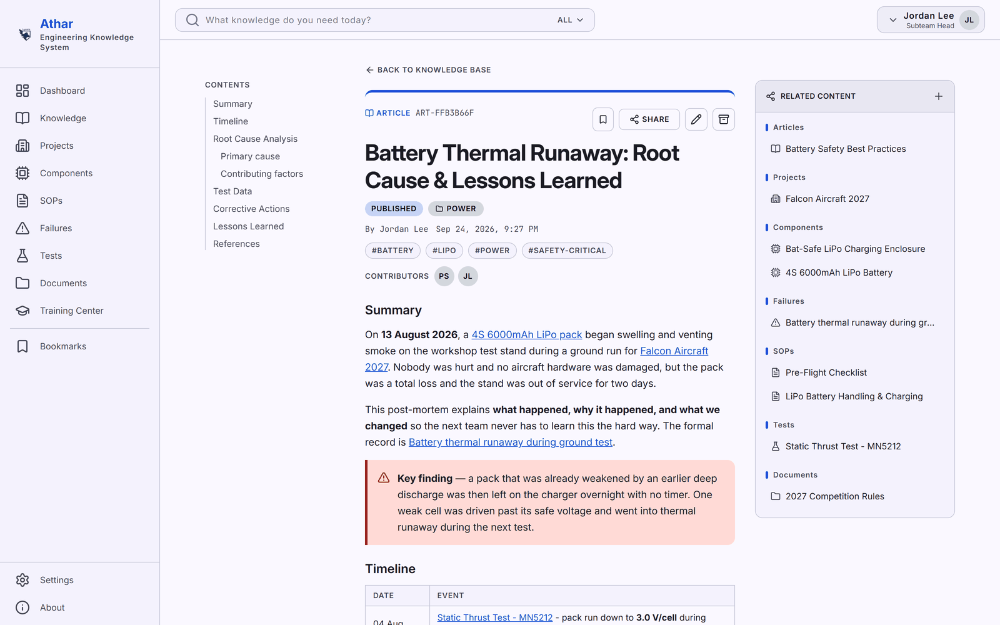

<div align="center">

# Athar (أثر)

**An open-source, self-hosted knowledge management system for student engineering teams.**

Projects, components, SOPs, failures, tests and lessons learned, linked together in one searchable knowledge base, so what your team knows outlives the people who learned it.

[](https://github.com/Lycans-AeroDesign/Athar/releases/latest)
[](https://github.com/Lycans-AeroDesign/Athar/actions/workflows/ci.yml)
[](LICENSE)

[Quickstart](#quickstart-docker) · [Features](#features) · [Deployment](DEPLOYMENT.md) · [Product spec](docs/VISION.md) · [Contributing](CONTRIBUTING.md)

</div>



## Why Athar?

Student engineering teams build up a huge amount of knowledge: designs, failures, procedures, flight history, decisions. Most of it lives in people's heads and leaves when they graduate. Athar lets a new member search the system and understand not just **what** the team does, but **why**.

> **athar** (أثر) `/ˈæ.θɑːr/` — _Arabic_: a trace or mark left behind by something that has passed.

Unlike a general-purpose wiki, Athar connects knowledge to the work itself:

- **Connected records.** A failure links to the components, tests, SOPs and project it involved, so context is never lost.
- **Built for onboarding.** Existing knowledge becomes structured courses for new members.
- **Yours to run.** Self-host it, own your data, and keep it running long after this season's team moves on.

Athar was built by [Lycans AeroDesign](https://github.com/Lycans-AeroDesign) for a university AeroDesign team, and is designed for any engineering team.

## Features

| Module | What it gives you |
|---|---|
| **Knowledge** | Articles and Q&A with categories, tags, attachments, cross-links, a draft → review → publish workflow and revision history. |
| **Engineering records** | Projects, components, failures, SOPs, tests and documents, all linked to each other. |
| **Workshop inventory** | Components double as inventory: location, quantity, stock status, a "needs ordering" view, and two-way CSV sync with your spreadsheet. |
| **Training Center** | Courses → modules → lessons with enrollment and progress tracking. Lessons reference existing knowledge instead of copying it. |
| **Search** | Ranked Postgres full-text search across every content type, tolerant of typos. |
| **Roles & organizations** | Five built-in roles enforced on every API request, and full data isolation, so one server can host several teams. |
| **Recognition** | Contribution leaderboard (monthly, yearly, lifetime) and a live activity feed. |
| **Backups** | Encrypted per-organization export and restore in the app, plus whole-server backups from the command line. |
| **English & Arabic** | The full interface in both languages, with right-to-left layout for Arabic. |

Also included: bookmarks and collections, public share links, a 30-day trash, and terms/privacy policy acceptance.

Three principles guide the design (see [`docs/VISION.md`](docs/VISION.md)):

1. **Self-hosted first.** Every team can run its own independent instance; one instance can also serve several isolated organizations.
2. **Connected knowledge.** Information links to related information, so context is discoverable instead of siloed.
3. **Server-enforced permissions.** The interface is never a security boundary; every request is authorized on the backend.

## Quickstart (Docker)

```bash
git clone https://github.com/Lycans-AeroDesign/Athar.git
cd Athar
python scripts/generate_env.py   # creates the .env files with real secrets
docker compose up
```

Open **http://localhost** (nginx in front of both apps). The frontend alone is on http://localhost:3000 and the API on http://localhost:8000.

**Deploying to a real server?** Use the production stack, which pulls the prebuilt images:

```bash
docker compose -f docker-compose.prod.yml pull
docker compose -f docker-compose.prod.yml up -d
```

It requires `SECRET_KEY`, `ALLOWED_HOSTS`, `CORS_ALLOWED_ORIGINS` and `DOMAIN` to be set. [`DEPLOYMENT.md`](DEPLOYMENT.md) has the full checklist, including HTTPS.

<details>
<summary><b>Running without Docker</b></summary>

You need a running PostgreSQL server (there is no SQLite fallback). Create the `.env` files first, either with `python scripts/generate_env.py` or by copying `backend/.env.example` and `frontend/.env.example`, and set `DATABASE_URL` in `backend/.env`.

```bash
# Backend (from backend/)
uv sync
uv run manage.py migrate
uv run manage.py runserver

# Frontend (from frontend/)
npm install
npm run dev        # http://localhost:3000
```

</details>

> **Prefer not to host it yourself?** We're exploring a managed Athar service run by Lycans AeroDesign. If your team would use it, [let us know](https://www.lycansteam.com/contact). Self-hosting will always remain available.

## Tech stack

| | |
|---|---|
| **Backend** | Django 6.1, Django REST Framework, OpenAPI via `drf-spectacular`, Python 3.14, `uv` |
| **Frontend** | Next.js 16 (App Router), React 19, TypeScript, Tailwind CSS v4 |
| **Data** | PostgreSQL 18, Redis + Celery for background jobs |
| **Files** | Local disk by default, or any S3-compatible storage (AWS S3, Cloudflare R2, Backblaze B2, MinIO) |
| **Deployment** | Docker Compose, nginx, Let's Encrypt HTTPS |
| **CI** | GitHub Actions: tests, linting, type checking (pyrefly), security scans |

<details>
<summary><b>Project structure</b></summary>

```text
backend/                  Django API
frontend/                 Next.js app
nginx/templates/          reverse proxy config (dev and production + HTTPS)
scripts/                  .env generator, HTTPS bootstrap, end-of-life check
docs/                     product spec, backups, operations, security notes
docker-compose.yml        development stack (hot reload)
docker-compose.prod.yml   production stack
DEPLOYMENT.md             server deployment checklist
```

</details>

## Backups

There are two ways to back up, for two different scopes:

- **One organization**, from **Settings > Backups**: an encrypted `.athar` archive of all that organization's data and files. It can be restored on the same server or on a new one.
- **The whole server**, from the command line: an encrypted database dump plus an archive of uploaded files.

```bash
docker compose exec backend python manage.py create_full_backup
```

See [`docs/BACKUPS.md`](docs/BACKUPS.md) for what's included, how encryption works, restoring, and moving to a new server.

## Languages

| Language | Direction | Status |
|---|---|---|
| English | LTR | ✅ Source language |
| العربية (Arabic) | RTL | ✅ Fully translated |

<details>
<summary><b>Adding a language</b></summary>

All UI text comes from `frontend/i18n/messages/<locale>.json`, and routes are prefixed with the locale (`/en/...`, `/ar/...`).

1. Add the language code to `locales` in `frontend/i18n/request.ts`, along with its display name (`localeNames`) and text direction (`localeDirections`).
2. Copy `frontend/i18n/messages/en.json` to `<code>.json` and translate the values, keeping the keys.

The language then appears in Settings > General automatically. There is no per-key fallback, so translate every key before release, and update the table above.

</details>

## Contributing

Contributions are welcome. See [`CONTRIBUTING.md`](CONTRIBUTING.md) for conventions and the PR checklist. To report a vulnerability, see [`SECURITY.md`](SECURITY.md).

## License

[Apache License 2.0](LICENSE) © 2026 Lycans AeroDesign Team.
